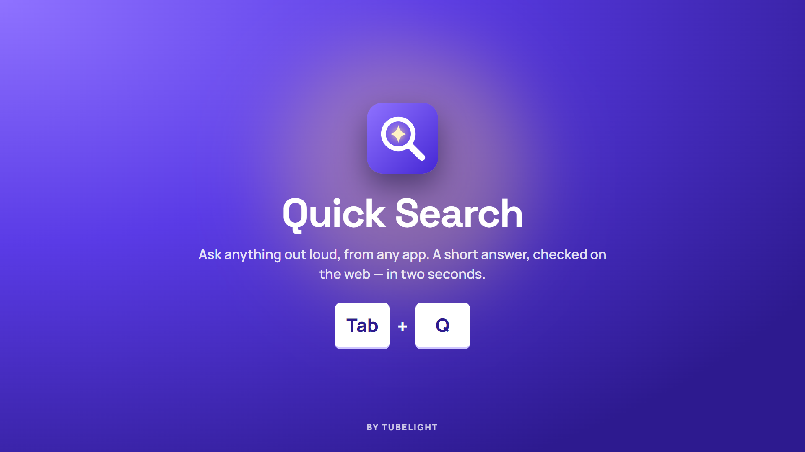
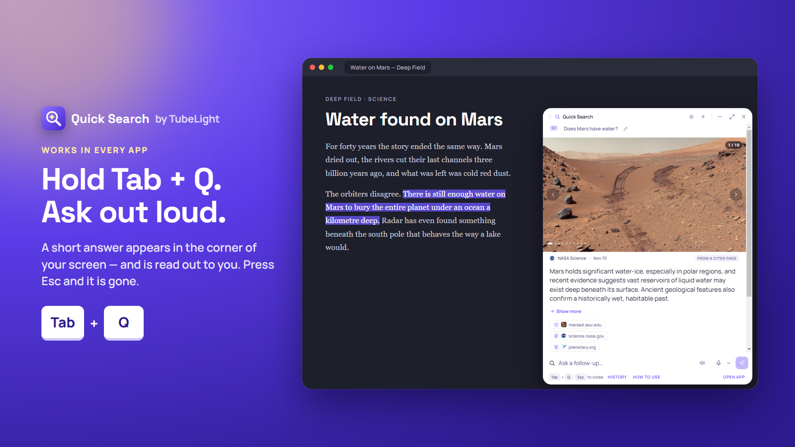
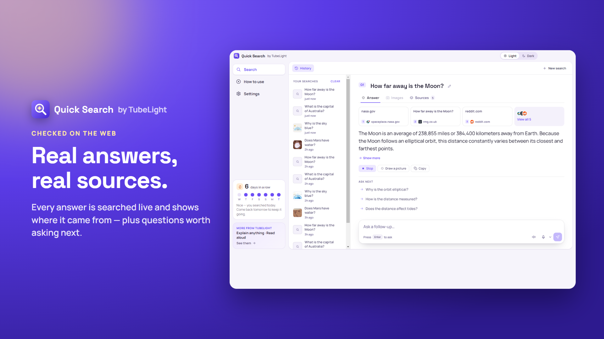
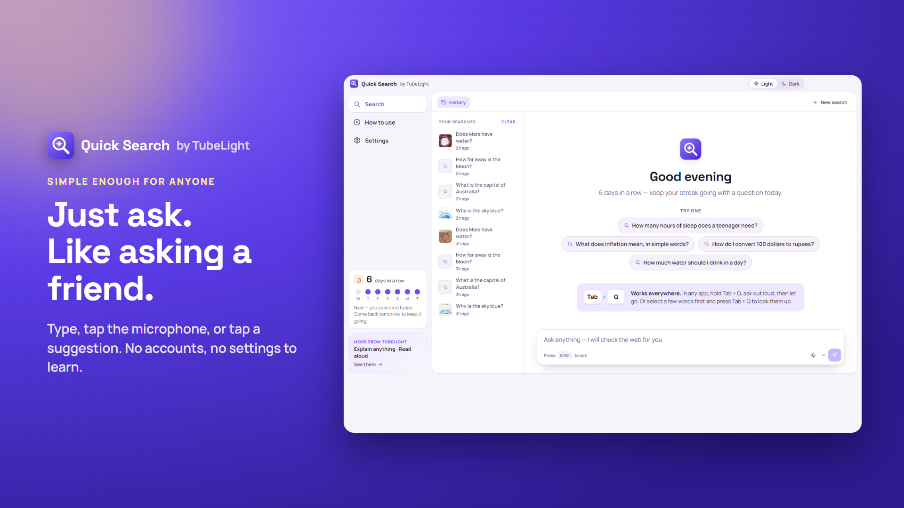
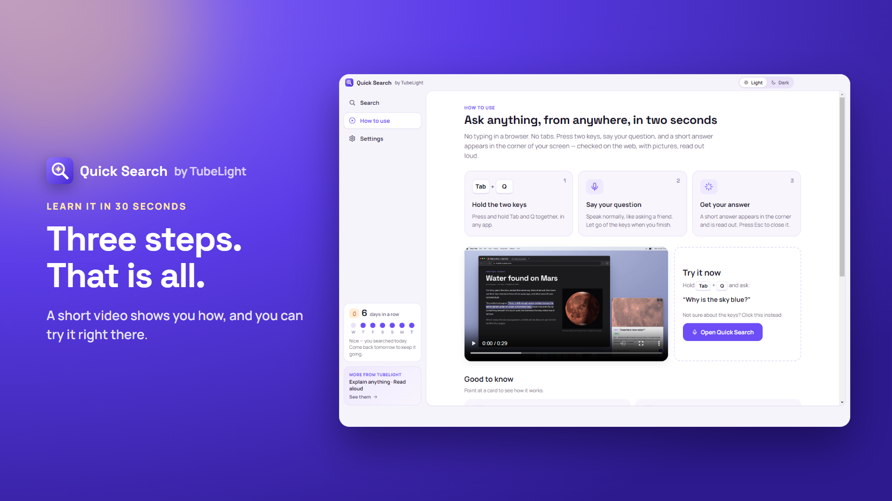
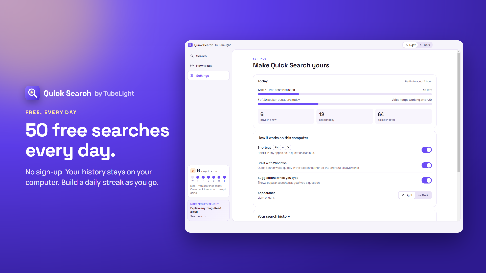
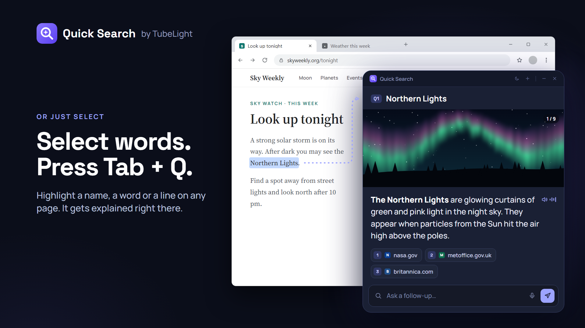
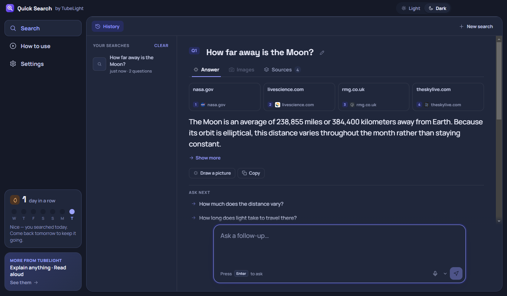

# Quick Search AI for Windows

### Instant Global Hotkey (Tab + Q) AI Assistant with Voice, Screen Vision &amp; Native Windows Overlay

  
  
  

  
  
  
  
  

 

---

## ⚡ Overview

**Quick Search AI** is a lightweight, distraction-free native Windows utility designed to answer questions without breaking your workflow. Whenever you wonder something while coding, writing, or researching:

1. **Hold `Tab + Q`** in any Windows application.
2. **Ask your question out loud** (or type).
3. **Release `Tab + Q`** — an instant, web-verified answer with real sources slides into the corner of your screen.
4. Press `Esc` and it is gone.

No browser tab chaos. No window switching. No context loss.

---

## 🌟 Core Product Features

### 01. Ask From Any App (`Tab + Q`)
Hold `Tab + Q` anywhere in Windows—over VS Code, Figma, Excel, browser tabs, or PDF readers. Speak naturally, and release the hotkey to get instant answers in a non-intrusive floating card.

---

### 02. Real Web Sources &amp; Live Citations
Never wonder where an answer came from. Every result is cross-checked in real-time against verified web sources with clickable citation chips and deep references.

---

### 03. Minimal, Distraction-Free Corner Overlay
Designed to disappear as fast as it appears. Quick Search occupies a discreet corner overlay that never steals permanent focus or interrupts your task. Tap `Esc` at any moment to dismiss immediately.

---

### 04. Learn in 30 Seconds
Built with instant discoverability. Includes a 30-second interactive on-screen tutorial, contextual tips, and keyboard hints that guide you effortlessly from first launch.

---

### 05. 50 Free Searches Every Day
Get 50 free high-speed web-verified searches every day with zero account creation or sign-in barrier. Hardware-bound device identity protects daily allowances seamlessly without collecting personal user profiles.

---

### 06. Highlight Text &amp; Instant Lookup
Highlight any term, error message, or code snippet in any document or website, then press `Tab + Q` to instantly look it up with relevant technical explanations.

---

### 07. Local-Only History &amp; Dark Mode
Full conversation history is stored strictly on your local machine using indexed storage. Switch seamlessly between dark and light themes matching your Windows OS preference, and clear your history with a single tap.

---

## 💻 System Requirements

* **Operating System:** Windows 10 (version 1809 or higher) or Windows 11 (64-bit)
* **Processor:** 1.6 GHz or faster (Intel, AMD, or ARM64)
* **Memory:** 2 GB RAM minimum (4 GB recommended)
* **Storage:** 150 MB available disk space
* **Network:** Broadband internet connection for real-time web verification

---

## 🔒 Privacy &amp; Security

* **Zero Sign-in Required:** Start using immediately without emails, passwords, or cloud accounts.
* **100% On-Device Conversation History:** Searches, queries, and past answers stay on your local drive and are never synced to public profiles.
* **Hardware-Bound Anti-Abuse Identity:** Uses cryptographically signed local machine identifiers to grant daily search allowances without tracking personal identity.
* **Zero Telemetry Profiling:** No background keystroke monitoring outside the designated hotkey invocation.

---

## 📬 Support &amp; Feedback

* **Website:** [tubelight.net](https://tubelight.net)
* **Email:** [viswasakthi.offl@gmail.com](mailto:viswasakthi.offl@gmail.com?subject=Quick%20Search%20AI%20Feedback)
* **Creator:** [Viswasakthi P on GitHub](https://github.com/viswasakthi3)

 

  Built by Viswasakthi P. © 2026 Quick Search AI. All rights reserved.

